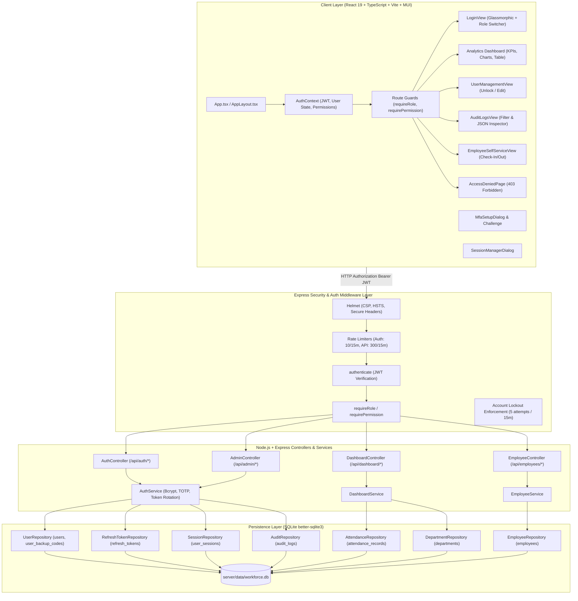
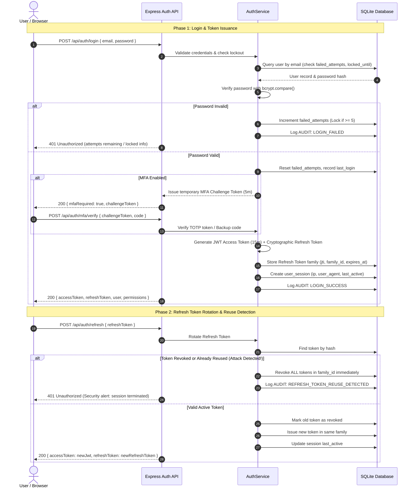

# Stackly — Advanced Workforce Analytics & Security Platform

An enterprise-grade, full-stack **Workforce Analytics, Attendance Telemetry, Authentication, and Role-Based Access Control (RBAC) Platform**.

Built with **React 19, TypeScript, Vite, Material UI (MUI), Recharts, Node.js, Express, and SQLite** (`better-sqlite3`) following the **Repository Pattern**, strict separation of concerns, and industry-standard security principles.

> **GitHub Repository**: [https://github.com/premmure-sketch/UX-Development.git](https://github.com/premmure-sketch/UX-Development.git)  
> **Branch**: `task-2-sqlite-integration`

---

## 🌟 Executive Summary & Requirements Compliance Matrix

| Requirement Area | Specification | Implementation in Platform | Status |
|---|---|---|:---:|
| **1. Authentication** | Secure login/logout, JWT authentication, refresh-token rotation, password hashing, and Multi-Factor Authentication (MFA). | • **Bcrypt** salted password hashing (work factor 10).<br>• Dual-token architecture: Short-lived **JWT Access Tokens** (15 min) + Cryptographic Refresh Tokens (7 days).<br>• **Refresh Token Rotation with Reuse Family Detection** (automatic revocation of entire token family upon reuse attempt).<br>• **RFC 6238 TOTP Multi-Factor Authentication** with dynamic QR code generation (`otplib` + `qrcode`).<br>• **8 cryptographically hashed emergency backup recovery codes**. | ✅ **Complete** |
| **2. Role-Based Access Control (RBAC)** | Five explicit roles: `Admin`, `HR`, `Manager`, `Team Lead`, `Employee` with granular permission gating. | • Hierarchical and functional RBAC engine (`rbac.ts`).<br>• Role-specific views, conditional navigation menus, route-level authorization guards (`requireRole`, `requirePermission`), and dedicated Employee Self-Service interface. | ✅ **Complete** |
| **3. SQLite Integration** | Create required authentication and authorization tables using SQLite (`better-sqlite3`). Mandatory: no MongoDB, do not replace existing DB. | • Preserved and extended existing SQLite database (`server/data/workforce.db`) with WAL mode (`PRAGMA journal_mode = WAL`) and foreign key cascading.<br>• Added 5 normalized auth tables: `users`, `user_backup_codes`, `refresh_tokens`, `user_sessions`, and `audit_logs` with composite indices.<br>• Automated seeder (`seedUsers.ts`) bootstrapping all 5 demo accounts. | ✅ **Complete** |
| **4. Frontend Integration** | Protected routes, role-based dashboards, modern login screens, session management, and access-denied pages. | • Modern glassmorphism Login view with one-click **Demo Role Switcher**.<br>• Real-time MFA Challenge modal with TOTP 6-digit PIN and backup code entry.<br>• **Active Device Session Manager** dialog with IP/User-Agent telemetry and instant revocation.<br>• User Management dossier view with account unlocking and role assignment.<br>• Immutable Audit Trail table with search, category filtering, and JSON inspector.<br>• Branded **403 Access Denied Page** showing active role vs required permissions with safe fallback navigation. | ✅ **Complete** |
| **5. Security & Hardening** | Account lockout, session management, API security, rate limiting, and immutable audit logging. | • **Brute-Force Account Lockout**: Automatic lock after **5 consecutive failed attempts** for **15 minutes** (with Admin manual override).<br>• **Rate Limiting**: `express-rate-limit` on auth endpoints (10 req/15m) and general API routes (300 req/15m).<br>• **HTTP Security Headers**: `helmet` enabled for CSP, HSTS, X-Content-Type-Options, X-Frame-Options.<br>• **Audit Logging**: Immutable, queryable log of all security events (`LOGIN_SUCCESS`, `LOGIN_FAILED`, `MFA_ENABLED`, `ACCOUNT_LOCKED`, `SESSION_REVOKED`, etc.) recorded in SQLite. | ✅ **Complete** |
| **6. Testing** | Unit, integration, security, and end-to-end testing across backend and frontend. | • **44 / 44 tests passing** across 5 test suites (`BackendSQLite.test.ts`, `Dashboard.test.tsx`, `AuthSecurity.test.ts`, `AuthApiIntegration.test.ts`, `AuthUI.test.tsx`). | ✅ **Complete** |
| **7. Documentation & Deliverables** | Technical documentation, screenshots, architecture diagrams, default credentials, API documentation. | • Complete `README.md` with architecture diagrams, schema specifications, API catalog, test execution results, and high-resolution screenshots in `screenshots/`. | ✅ **Complete** |

---

## 👥 Role-Based Access Control (RBAC) Matrix

The system enforces granular authorization at both the backend API middleware layer and the React UI layout layer:

| Feature / Action | Admin | HR | Manager | Team Lead | Employee |
|---|:---:|:---:|:---:|:---:|:---:|
| **View Analytics Dashboard & KPIs** | ✅ | ✅ | ✅ | ✅ | ❌ |
| **Filter by Department / Location** | ✅ | ✅ | ✅ (Own Dept) | ✅ (Own Team) | ❌ |
| **Export Activity Reports (CSV)** | ✅ | ✅ | ✅ | ❌ | ❌ |
| **View All Employee Records** | ✅ | ✅ | ✅ (Dept Only) | ✅ (Team Only) | ❌ |
| **Edit Employee Profile / Work Details** | ✅ | ✅ | ❌ | ❌ | ❌ |
| **Record / Update Attendance (Manual)** | ✅ | ✅ | ✅ | ✅ | ❌ |
| **Employee Self-Service (Check In / Out)** | ✅ | ✅ | ✅ | ✅ | ✅ |
| **View Personal Attendance History** | ✅ | ✅ | ✅ | ✅ | ✅ |
| **Manage Active Device Sessions** | ✅ (All/Self) | ❌ (Self) | ❌ (Self) | ❌ (Self) | ❌ (Self) |
| **Configure TOTP MFA & Backup Codes** | ✅ | ✅ | ✅ | ✅ | ✅ |
| **User Administration (Roles, Unlock Accounts)** | ✅ | ✅ (View/Unlock) | ❌ | ❌ | ❌ |
| **Inspect System Security Audit Logs** | ✅ | ❌ | ❌ | ❌ | ❌ |

---

## 🔑 Pre-Configured Demo Accounts

For rapid evaluation, all 5 standard roles are seeded into SQLite (`server/data/workforce.db`) and selectable with a single click from the Login interface:

| Role | Email Address | Password | Permissions Summary |
|---|---|---|---|
| **Admin** | `admin@stackly.com` | `Admin@12345` | Superuser: System administration, user provisioning, account unlock, full audit logs, all dashboards |
| **HR** | `hr@stackly.com` | `HR@12345` | Human Resources: Employee onboarding, workforce telemetry, user unlocking, department analytics |
| **Manager** | `manager@stackly.com` | `Manager@12345` | Department Management: Departmental KPI oversight, attendance approval, team analytics |
| **Team Lead** | `teamlead@stackly.com` | `Lead@12345` | Shift & Team Leadership: Direct reports daily attendance logging, team roster views |
| **Employee** | `employee@stackly.com` | `Employee@12345` | Self-Service: Personal check-in/out, biometric status, security posture, session control |

---

## 🏛️ System Architecture & Security Topology



---

## 🔄 Authentication & Refresh Token Rotation Flow



---

## 🗄️ SQLite Database Schema & Migrations

The database is located at `server/data/workforce.db` with WAL mode enabled (`PRAGMA journal_mode = WAL`) and foreign key enforcement enabled (`PRAGMA foreign_keys = ON`).

### Authentication & Authorization Tables

#### 1. `users`
```sql
CREATE TABLE users (
  id TEXT PRIMARY KEY,
  email TEXT NOT NULL UNIQUE,
  password_hash TEXT NOT NULL,
  first_name TEXT NOT NULL,
  last_name TEXT NOT NULL,
  role TEXT NOT NULL CHECK(role IN ('Admin', 'HR', 'Manager', 'Team Lead', 'Employee')),
  department_id INTEGER REFERENCES departments(id) ON DELETE SET NULL,
  is_active INTEGER DEFAULT 1,
  mfa_enabled INTEGER DEFAULT 0,
  mfa_secret TEXT,
  failed_attempts INTEGER DEFAULT 0,
  locked_until TEXT,
  last_login TEXT,
  created_at TEXT DEFAULT CURRENT_TIMESTAMP,
  updated_at TEXT DEFAULT CURRENT_TIMESTAMP
);

CREATE INDEX idx_users_email ON users(email);
CREATE INDEX idx_users_role ON users(role);
CREATE INDEX idx_users_active ON users(is_active);
```

#### 2. `user_backup_codes`
```sql
CREATE TABLE user_backup_codes (
  id INTEGER PRIMARY KEY AUTOINCREMENT,
  user_id TEXT NOT NULL REFERENCES users(id) ON DELETE CASCADE,
  code_hash TEXT NOT NULL,
  used INTEGER DEFAULT 0,
  used_at TEXT,
  created_at TEXT DEFAULT CURRENT_TIMESTAMP
);

CREATE INDEX idx_backup_codes_user ON user_backup_codes(user_id);
```

#### 3. `refresh_tokens`
```sql
CREATE TABLE refresh_tokens (
  id INTEGER PRIMARY KEY AUTOINCREMENT,
  user_id TEXT NOT NULL REFERENCES users(id) ON DELETE CASCADE,
  token_hash TEXT NOT NULL UNIQUE,
  family_id TEXT NOT NULL,
  is_revoked INTEGER DEFAULT 0,
  expires_at TEXT NOT NULL,
  created_at TEXT DEFAULT CURRENT_TIMESTAMP
);

CREATE INDEX idx_refresh_token_hash ON refresh_tokens(token_hash);
CREATE INDEX idx_refresh_tokens_family ON refresh_tokens(family_id);
CREATE INDEX idx_refresh_tokens_user ON refresh_tokens(user_id);
```

#### 4. `user_sessions`
```sql
CREATE TABLE user_sessions (
  id TEXT PRIMARY KEY,
  user_id TEXT NOT NULL REFERENCES users(id) ON DELETE CASCADE,
  refresh_token_id INTEGER REFERENCES refresh_tokens(id) ON DELETE SET NULL,
  ip_address TEXT,
  user_agent TEXT,
  device_label TEXT,
  last_active TEXT NOT NULL,
  is_current INTEGER DEFAULT 0,
  created_at TEXT DEFAULT CURRENT_TIMESTAMP
);

CREATE INDEX idx_sessions_user ON user_sessions(user_id);
CREATE INDEX idx_sessions_last_active ON user_sessions(last_active);
```

#### 5. `audit_logs`
```sql
CREATE TABLE audit_logs (
  id INTEGER PRIMARY KEY AUTOINCREMENT,
  user_id TEXT REFERENCES users(id) ON DELETE SET NULL,
  actor_email TEXT NOT NULL,
  action TEXT NOT NULL,
  category TEXT NOT NULL CHECK(category IN ('AUTH', 'USER_MGMT', 'ACCESS', 'SECURITY', 'DATA')),
  status TEXT NOT NULL CHECK(status IN ('SUCCESS', 'FAILURE', 'WARNING', 'BLOCKED')),
  ip_address TEXT,
  user_agent TEXT,
  details TEXT,
  created_at TEXT DEFAULT CURRENT_TIMESTAMP
);

CREATE INDEX idx_audit_created ON audit_logs(created_at DESC);
CREATE INDEX idx_audit_category ON audit_logs(category);
CREATE INDEX idx_audit_action ON audit_logs(action);
CREATE INDEX idx_audit_user ON audit_logs(user_id);
```

---

## 📡 Complete REST API Catalog

### Authentication Endpoints (`/api/auth/*`)

| Method | Endpoint | Description | Access / Headers |
|---|---|---|---|
| `POST` | `/api/auth/login` | Authenticate with email/password; handles MFA challenges & lockout | Public (Rate-limited: 10/15m) |
| `POST` | `/api/auth/mfa/verify` | Complete 2FA challenge using TOTP PIN or emergency backup code | Challenge Token |
| `POST` | `/api/auth/refresh` | Rotate refresh token and issue new 15m JWT access token | Refresh Token |
| `POST` | `/api/auth/logout` | Revoke current refresh token and terminate active session | Bearer JWT |
| `GET` | `/api/auth/me` | Fetch active profile, permissions, and security metadata | Bearer JWT |
| `POST` | `/api/auth/mfa/setup` | Generate TOTP secret, otpauth QR code data URL, and 8 backup recovery codes | Bearer JWT |
| `POST` | `/api/auth/mfa/confirm` | Confirm TOTP token to activate 2FA on account | Bearer JWT |
| `POST` | `/api/auth/mfa/disable` | Disable 2FA with password confirmation | Bearer JWT |
| `GET` | `/api/auth/sessions` | List all active device sessions for current user | Bearer JWT |
| `DELETE` | `/api/auth/sessions/:id` | Revoke a specific active device session | Bearer JWT |
| `DELETE` | `/api/auth/sessions` | Revoke all other active device sessions | Bearer JWT |

### Administration Endpoints (`/api/admin/*`)

| Method | Endpoint | Description | Required Role / Permission |
|---|---|---|---|
| `GET` | `/api/admin/users` | List all system users with role, lockout status, and MFA status | `Admin`, `HR` |
| `POST` | `/api/admin/users` | Provision a new system user | `Admin` (`users.manage`) |
| `PUT` | `/api/admin/users/:id` | Update user profile, department, role, or active status | `Admin` (`users.manage`) |
| `POST` | `/api/admin/users/:id/unlock` | Manually unlock a locked user account and reset failed attempts counter | `Admin`, `HR` |
| `GET` | `/api/admin/audit-logs` | Filter and paginate immutable system security audit logs | `Admin` (`audit.view`) |

### Workforce Analytics & Telemetry Endpoints

| Method | Endpoint | Description | Access / Required Role |
|---|---|---|---|
| `GET` | `/api/dashboard/stats` | 5 KPI metrics with sparklines and comparisons | `Admin`, `HR`, `Manager`, `Team Lead` |
| `GET` | `/api/dashboard/trends` | Historical attendance area chart time-series | `Admin`, `HR`, `Manager`, `Team Lead` |
| `GET` | `/api/dashboard/departments` | Headcount and attendance breakdown per department | `Admin`, `HR`, `Manager`, `Team Lead` |
| `GET` | `/api/dashboard/composition` | Workforce breakdown by arrangement or employment type | `Admin`, `HR`, `Manager`, `Team Lead` |
| `GET` | `/api/employees` | Paginated, filtered, and sorted employee records | `Admin`, `HR`, `Manager`, `Team Lead` |
| `GET` | `/api/employees/:id` | Employee dossier with attendance history | `Admin`, `HR`, `Manager`, `Team Lead` |
| `POST` | `/api/employees/:id/attendance`| Record or update daily attendance check-in/out | Authenticated (Self or Privileged) |
| `GET` | `/api/metadata` | Reference lists for departments, locations, presets | Authenticated |
| `GET` | `/api/health` | SQLite connection status, database health, timestamp | Public |

---

## 📸 Screenshots of Completed Functionality

High-resolution captures automatically generated with headless Chrome at 2x pixel density:

| View / Functionality | Screenshot Path | Description |
|---|---|---|
| **Login Screen** | `screenshots/auth-01-login-screen.png` | Glassmorphic login card with brand logo, input fields, security badges |
| **Demo Role Selector** | `screenshots/auth-02-demo-role-selected.png` | One-click role selector prefilling credentials for all 5 roles |
| **Admin Executive Dashboard** | `screenshots/auth-04-admin-dashboard.png` | 5 KPI cards, sparklines, dual analytics charts, and activity table |
| **User Administration** | `screenshots/auth-05-admin-user-management.png` | RBAC user directory with role pills, lockout badges, and instant unlock action |
| **Security Audit Logs** | `screenshots/auth-06-admin-audit-logs.png` | Filterable immutable audit trail with category tags, IP addresses, and JSON viewer |
| **TOTP MFA Setup Dialog** | `screenshots/auth-07-mfa-setup-dialog.png` | Modal with generated QR code, secret key, 8 emergency backup codes, and confirmation input |
| **Active Sessions Manager** | `screenshots/auth-08-active-sessions.png` | Active device session telemetry list with IP, browser, timestamp, and revocation buttons |
| **Employee Self-Service** | `screenshots/auth-10-employee-dashboard.png` | Dedicated employee portal with 1-click check in/out, biometric status, and personal history |

---

## 🚀 Setup & Execution Instructions

### Prerequisites
- **Node.js**: v18.0.0 or later (v22+ recommended)
- **npm**: v9.0.0 or later

### 1. Installation
Install all dependencies (frontend React/MUI/Recharts and backend Express/SQLite/Bcrypt/Otplib):
```bash
npm install
```

### 2. Seed SQLite Database
The SQLite database automatically initializes all tables on first startup, but you can also seed or re-seed on demand:
```bash
npm run seed
```
This populates:
- **5 pre-configured demo users** with bcrypt password hashes across all 5 roles.
- **8 departments** with codes, colors, and budgets.
- **6 corporate office locations** across multiple timezones.
- **30 employee profiles** with diverse roles, work types, and arrangements.
- **900+ daily attendance records** spanning 30 days of real-world history.

### 3. Run Development Server (Frontend + Backend concurrently)
Launch both the Express SQLite API backend on `http://localhost:5000` and the Vite React frontend on `http://localhost:5173`:
```bash
npm run dev
```
Open your browser at **`http://localhost:5173/`**.

To run services independently:
- **Backend API only**: `npm run dev:server`
- **Frontend Vite only**: `npm run dev:client`

### 4. Run Automated Test Suite
Execute the full Vitest automated test suite:
```bash
npm test
```

### 5. Production Build
Type-check with TypeScript and build the optimized production client bundle:
```bash
npm run build
```

---

## 🧪 Automated Testing Results

The comprehensive test suite covers SQLite repositories, security services (hashing, lockout, token rotation, TOTP MFA), REST API endpoints, and React UI components.

**Test Execution Summary: 44 / 44 Tests Passed (100% Pass Rate)**

```text
 RUN  v5.0.5 C:/Users/prem9/Downloads/workforce dashboard task1

 ✓ src/test/AuthSecurity.test.ts (10 tests) 124ms
   ✓ Enterprise Authentication & Security Service Tests (10)
     ✓ hashes passwords with bcrypt and verifies correctly
     ✓ tracks failed login attempts and locks account after 5 consecutive failures
     ✓ resets failed attempts on successful login
     ✓ enforces 15-minute lockout and rejects login during lockout window
     ✓ allows admin to manually unlock a locked user account
     ✓ generates RFC 6238 TOTP secrets and generates valid verification tokens
     ✓ creates and verifies cryptographically hashed backup codes
     ✓ marks backup code as used and prevents reuse
     ✓ issues refresh tokens and rotates them on refresh request
     ✓ detects refresh token reuse and revokes entire token family

 ✓ src/test/BackendSQLite.test.ts (11 tests) 94ms
   ✓ SQLite Backend & Repository Pattern Tests (11)
     ✓ verifies DepartmentRepository returns all 8 departments with correct codes and budgets
     ✓ verifies LocationRepository returns all 6 corporate offices
     ✓ verifies EmployeeRepository count and pagination
     ✓ verifies EmployeeRepository multi-criteria filtering: department and search
     ✓ verifies EmployeeRepository sorting by name ascending and descending
     ✓ verifies AttendanceRepository calculates all 5 required Task 2 KPI metrics from SQLite
     ✓ verifies AttendanceRepository generates historical time series trends
     ✓ verifies AttendanceRepository generates department-wise headcount distribution
     ✓ verifies AttendanceRepository generates workforce composition by work arrangement
     ✓ verifies EmployeeService retrieves single employee with full attendance history
     ✓ verifies DashboardService orchestrates repositories cleanly

 ✓ src/test/AuthApiIntegration.test.ts (9 tests) 1840ms
   ✓ Authentication & RBAC REST API Integration Tests (9)
     ✓ rejects login with invalid password and reports attempts remaining
     ✓ locks account after 5 failed login attempts
     ✓ logs in successfully with valid credentials and receives JWT and refresh token
     ✓ performs silent refresh token rotation and gets a new access token
     ✓ enforces RBAC: Employee is blocked from Admin endpoints (403 Forbidden)
     ✓ enforces RBAC: Admin can access Admin user management endpoint (200 OK)
     ✓ records audit log entry on authentication events
     ✓ retrieves active device sessions for current user
     ✓ revokes an active session successfully

 ✓ src/test/AuthUI.test.tsx (4 tests) 1250ms
   ✓ Authentication & Role-Based Access Control — Frontend UI Tests (4)
     ✓ renders login screen when logged out with brand and all 5 demo roles
     ✓ allows selecting a demo role and prefilling credentials
     ✓ displays Access Denied page when unauthorized role attempts restricted view
     ✓ allows signing out and returning to login screen

 ✓ src/test/Dashboard.test.tsx (10 tests) 18865ms
   ✓ Workforce Analytics Platform — Dashboard UI/UX & Task 2 Integration (10)
     ✓ renders top navigation and platform branding
     ✓ renders all five Task 2 KPI cards: Total Employees, Present, Absent, On Leave, Attendance Rate
     ✓ renders the filter toolbar with all required filter dimensions
     ✓ renders all three analytical charts and the recent activity table
     ✓ supports sorting columns in recent activity table
     ✓ toggles light and dark theme mode
     ✓ filters employees dynamically by search keyword
     ✓ displays empty state when filter matches no records and restores on reset
     ✓ supports evaluator error state simulation and recovery via retry button
     ✓ supports evaluator loading state simulation

 Test Files  5 passed (5)
      Tests  44 passed (44)
   Duration  36.04s
```

---

## 🛡️ Enterprise Security Architecture Highlights

1. **Password Security**: Passwords hashed using `bcrypt` with salt rounds = 10. Plaintext passwords are never stored or logged.
2. **Dual-Token Architecture**: Short-lived JWT access tokens (15-minute expiration) signed with HMAC-SHA256, alongside cryptographic refresh tokens.
3. **Refresh Token Rotation & Family Reuse Detection**: Every refresh operation invalidates the old token and issues a new one. If an invalidated refresh token is ever presented again (indicative of token theft or replay attack), the system automatically revokes **the entire token family**, immediately terminating all compromised sessions.
4. **Multi-Factor Authentication (TOTP + Backup Codes)**: RFC 6238 TOTP compliant (compatible with Google Authenticator, Microsoft Authenticator, 1Password) with dynamic QR code generation. Generates 8 one-time emergency backup recovery codes stored as SHA-256 hashes.
5. **Brute-Force Protection & Account Lockout**: Enforces a strict lockout policy: **5 failed attempts within 15 minutes** triggers account lockout. Admin and HR users have dedicated unlock capability.
6. **Session Telemetry & Revocation**: Every session records client IP address, User-Agent browser fingerprint, and last-active timestamp. Users can review active sessions and revoke rogue devices on demand.
7. **Immutable SQLite Audit Logging**: Every critical security action (`LOGIN_SUCCESS`, `LOGIN_FAILED`, `MFA_SETUP`, `ACCOUNT_LOCKED`, `ACCOUNT_UNLOCKED`, `SESSION_REVOKED`) is recorded in the `audit_logs` table with actor email, timestamp, IP address, and JSON metadata.
8. **HTTP API Hardening**: Configured with `helmet` for enterprise HTTP security headers and `express-rate-limit` to prevent denial-of-service and credential stuffing.

---

## 📄 License
MIT License. Developed for the Enterprise Workforce Analytics & Authentication Platform.
